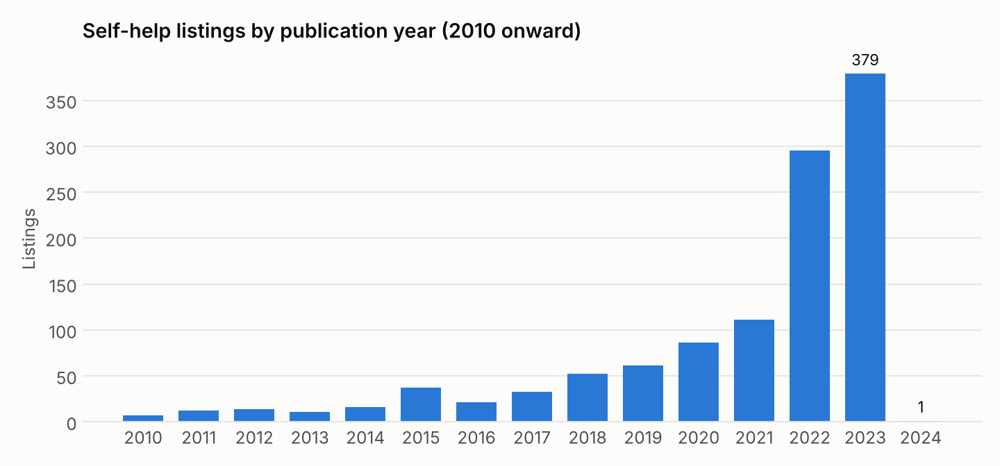
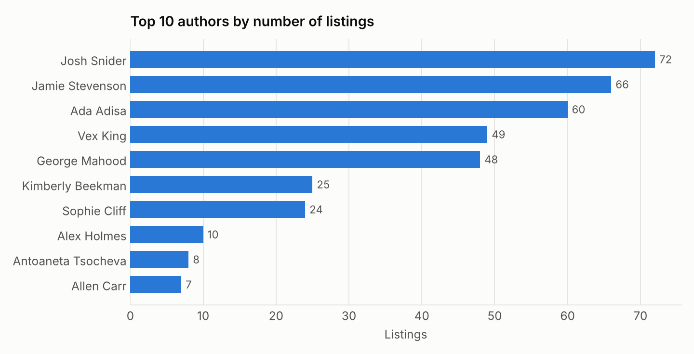

# Self-Help Book Recommender: Amazon UK

An end-to-end mini data project. It scrapes self-help book listings from Amazon UK, cleans and explores the data, loads it into **PostgreSQL**, answers questions with **SQL**, and builds a **content-based recommender** that suggests similar books from a given title.


## Pipeline

```
Amazon UK (72 result pages)
   │  book.py      requests + BeautifulSoup → books.csv (title, url, author, year, price)
   ▼
   │  eda.py       clean year & price, distributions, word cloud, top authors (pandas, Matplotlib, Plotly)
   ▼
   │  postgre.py   create `amazon` database + `books` table, bulk insert (psycopg2 execute_values)
   ▼
   │  app.py       SQL queries (GROUP BY year, sub-query for max price) → TF-IDF + cosine similarity recommender
```

## The data

**1,368 listings** were scraped (May 2023). Because sponsored results repeat across pages, they cover **995 unique titles**. The median price is **£10.99**.



Most listings were published in 2022–23, so the bestseller pages are dominated by recent releases.



A handful of self-published authors with large back catalogues account for a big share of the listings.

## How the recommender works

It's **content-based**: every title is turned into a TF-IDF vector (English stop words removed), and books are ranked by **cosine similarity** to the title you enter.

Example: input *"Atomic Habits: An Easy and Proven Way to Build Good Habits and Break Bad Ones"*

| # | Recommended |
|---|---|
| 1 | Designing Your Life: For Fans of Atomic Habits |
| 2 | The Kindness Method: Changing Habits for Good |
| 3 | Tiny Habits: The Small Changes That Change Everything |
| 4 | The Easy Way to Control Alcohol |
| 5 | The Easy Way to Stop Smoking |

The first three are good matches. Results 4–5 show the main limitation: with titles alone, a shared word ("Easy") can outweigh what the book is actually about.

## Running it

**Prerequisites:** Python 3.10+ and a local PostgreSQL server.

```bash
git clone https://github.com/jamesekene8/Books-Recommendation
cd Books-Recommendation
pip install -r requirements.txt
cp .env.example .env        # set your Postgres user, password and port
python app.py               # scrape → EDA → load to Postgres → query → recommend
```

Amazon's page markup changes often, so the scraper may need its CSS selectors updated. The `books.csv` snapshot from the original run is included, so the EDA and recommender can be run without re-scraping.

## What I'd improve next

- [ ] De-duplicate titles before vectorising (sponsored listings repeat)
- [ ] Use richer features than titles: descriptions, categories, ratings
- [ ] Compare with a sentence-embedding model (e.g. `all-MiniLM-L6-v2`) for semantic similarity
- [ ] Wrap the recommender in a small Streamlit app

## Author

**James Uguna**: [GitHub](https://github.com/jamesekene8)
